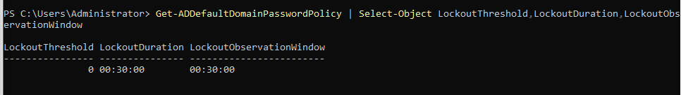
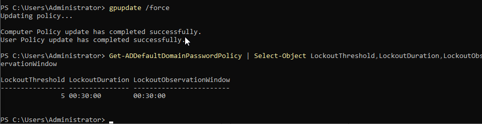
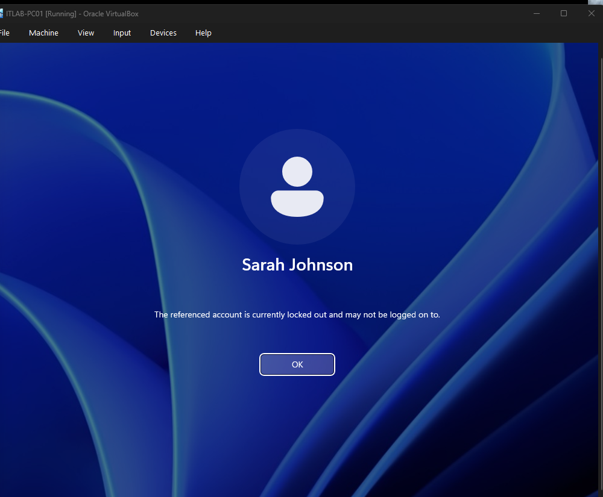
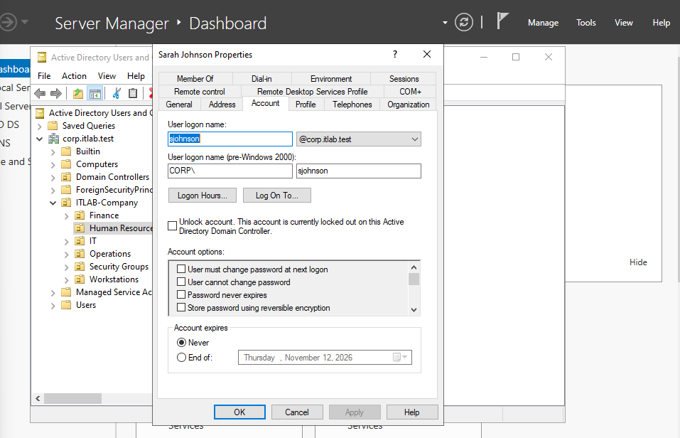
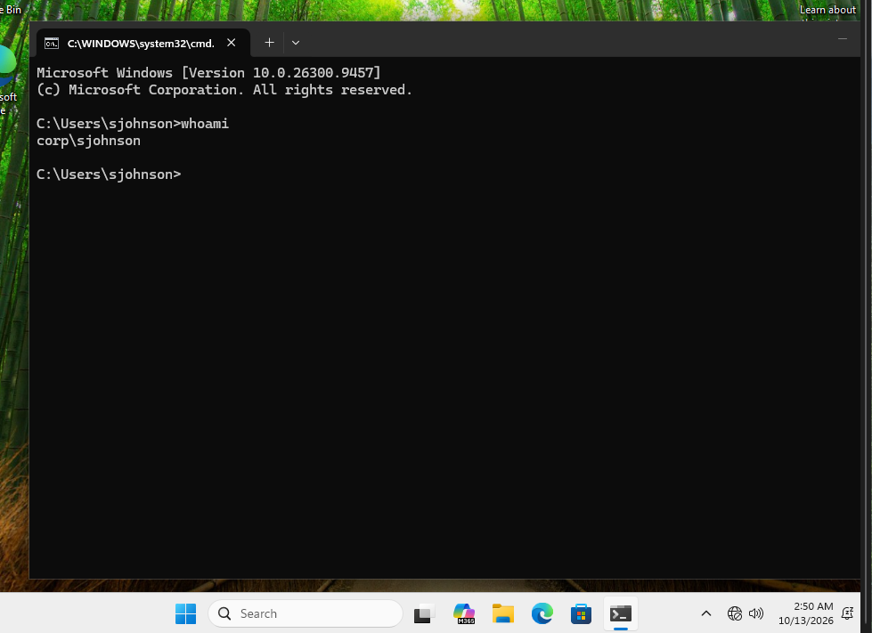

# INC-001 — Active Directory Account Lockout and Recovery

**Status:** Resolved  
**Environment:** Enterprise IT Support & Help Desk Lab  
**Affected User:** Sarah Johnson (Human Resources)  
**Account:** CORP\sjohnson  
**Workstation:** ITLAB-PC01  
**Domain Controller:** ITLAB-DC01  
**Domain:** corp.itlab.test  
**Priority:** Medium (simulated)

## Incident Description

A simulated Human Resources employee was unable to sign in to her Windows 11 domain-joined workstation because her Active Directory account had been locked.

Windows displayed the message: "The referenced account is currently locked out and may not be logged on to."

## Investigation and Troubleshooting

1. Reviewed the domain account lockout policy using PowerShell.
2. Identified that the original account lockout threshold was set to zero.
3. Configured the lab domain's lockout threshold to five invalid sign-in attempts, with a 30-minute lockout duration and observation window.
4. Applied Group Policy updates and verified the effective domain password policy.
5. Simulated five unsuccessful authentication attempts using the test account.
6. Confirmed the account lockout through Windows sign-in and Active Directory Users and Computers.

## Root Cause

The account lockout was intentionally triggered by repeated incorrect password attempts during a controlled lab simulation.

## Resolution

Access was restored by unlocking the affected account through Active Directory Users and Computers.

## Verification

Successfully signed in to ITLAB-PC01 using Sarah Johnson's domain credentials.

Executed `whoami` and confirmed the authenticated identity as `corp\sjohnson`.

## Outcome

**Resolved.** The lab successfully demonstrated account lockout policy configuration, user-account troubleshooting, Active Directory account recovery, and post-resolution verification.

## Supporting Evidence

### Account Lockout Policy

### Incident Investigation

### Resolution Verification

*This incident was simulated in an isolated virtual lab using fictional employee accounts.*