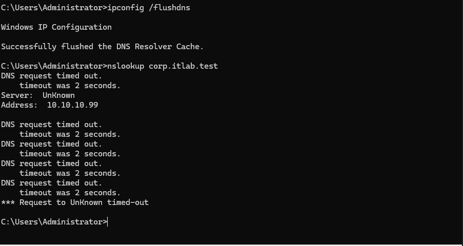
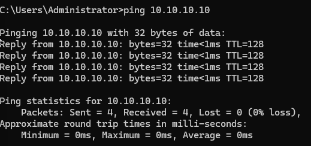
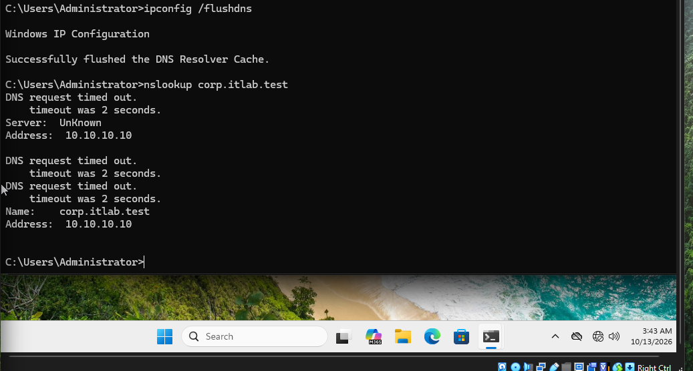
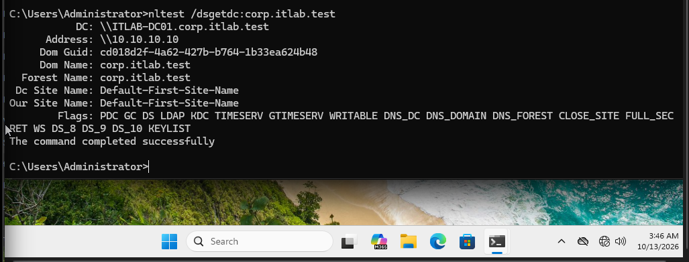

# INC-002 — DNS Resolution Failure and Recovery

**Status:** Resolved  
**Category:** Network and DNS Troubleshooting  
**Priority:** Medium (simulated)  
**Environment:** Windows Server 2022 / Windows 11  
**Affected Workstation:** ITLAB-PC01  
**Domain Controller:** ITLAB-DC01  
**Domain:** corp.itlab.test

## Incident Description

A simulated employee experienced difficulty resolving the corporate Active Directory domain because the workstation was configured with an incorrect DNS server address.

## Symptoms

- Corporate domain name resolution failed.
- DNS requests repeatedly timed out.
- The workstation could still communicate with the domain controller using its IP address.

## Investigation and Troubleshooting

1. Verified the workstation's original network configuration.
2. Simulated a DNS misconfiguration by changing the preferred DNS server from `10.10.10.10` to `10.10.10.99`.
3. Cleared the DNS resolver cache using `ipconfig /flushdns`.
4. Executed `nslookup corp.itlab.test` and confirmed that DNS requests timed out.
5. Tested network connectivity using `ping 10.10.10.10`.
6. Confirmed four successful ping replies with zero packet loss.
7. Determined that basic IP connectivity was functioning and the failure was related to DNS configuration.

## Root Cause

The workstation was configured to use `10.10.10.99`, an incorrect DNS server address, instead of the domain controller's DNS server at `10.10.10.10`.

## Resolution

Restored the workstation's preferred DNS server to `10.10.10.10` and cleared the DNS resolver cache.

## Verification

- Successfully resolved `corp.itlab.test` to `10.10.10.10`.
- Executed `nltest /dsgetdc:corp.itlab.test`.
- Confirmed successful discovery of `ITLAB-DC01.corp.itlab.test`.
- Verified that Windows could locate the domain controller's Active Directory services.

## Outcome

**Resolved.** DNS resolution and domain controller discovery were successfully restored.

## Supporting Evidence

### DNS Resolution Failure

### Network Connectivity Verification

### DNS Resolution Restored

### Domain Controller Discovery

---

*This incident was simulated in an isolated enterprise IT support lab for educational and professional portfolio purposes.*