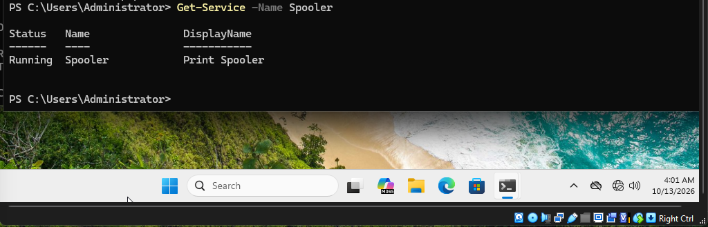
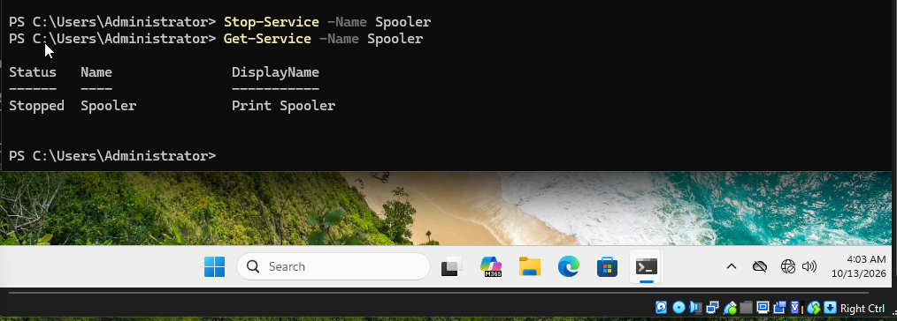
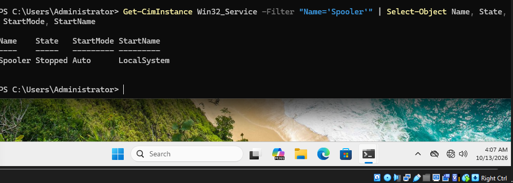
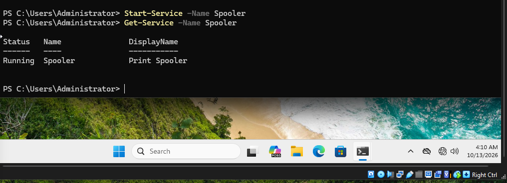

# INC-003 — Windows Print Spooler Service Failure and Recovery

**Status:** Resolved  
**Category:** Windows Service Troubleshooting  
**Priority:** Medium (simulated)  
**Affected Workstation:** ITLAB-PC01  
**Operating System:** Windows 11  
**Domain:** corp.itlab.test

## Incident Description

A simulated employee reported that the Windows printing service was unavailable.

The Print Spooler service was intentionally stopped in a controlled lab to simulate a Windows service failure.

## Investigation and Troubleshooting

1. Established the initial service status using `Get-Service -Name Spooler`.
2. Simulated the incident using `Stop-Service -Name Spooler`.
3. Confirmed the service entered the `Stopped` state.
4. Investigated the service configuration using `Get-CimInstance Win32_Service`.
5. Verified that the startup mode remained `Auto` and the service account was `LocalSystem`.
6. Determined that the service had been stopped without changing its automatic startup configuration.

## Root Cause

The Print Spooler service was intentionally stopped during the troubleshooting simulation.

## Resolution

Restored the service using:

`Start-Service -Name Spooler`

## Verification

Executed `Get-Service -Name Spooler` and confirmed that the service status changed to `Running`.

No physical printer or print-job functionality was tested.

## Outcome

**Resolved — service availability restored.**

This simulation demonstrated Windows service investigation, PowerShell troubleshooting, service restoration, and verification.

## Supporting Evidence

### Initial Service Status

### Simulated Service Failure

### Service Configuration Investigation

### Service Recovery

---

*This incident was simulated in an isolated virtual lab for educational and professional portfolio purposes.*